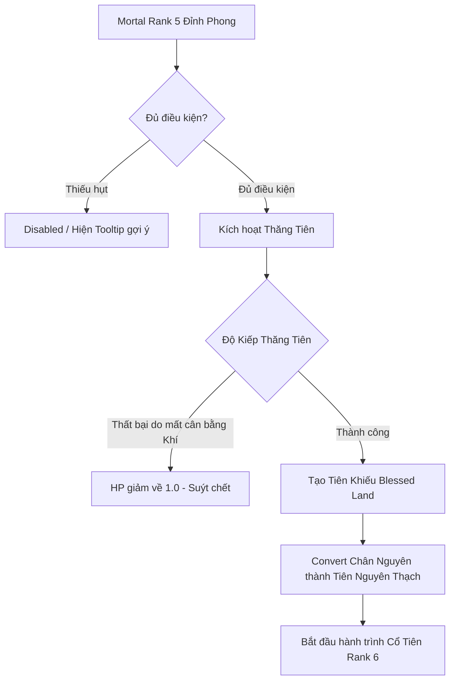

# 📜 CẨM NANG TU LUYỆN - GUWORLD WIKI 📜
*Chào mừng Cổ sư đến với thế giới Cổ Chân Nhân khắc nghiệt, nơi lợi ích là trên hết và sinh tồn là mục tiêu tối thượng!*

> [!IMPORTANT]
> **Quy luật căn bản của thiên địa:**
> *"Nhân là vạn vật chi linh, Cổ là thiên địa chi tinh."*
> Trong GuWorld, con người không có sức mạnh vật lý hay phép thuật bẩm sinh. Bản thân cổ sư chỉ là một vật chứa (Không Khiếu) đựng Chân Nguyên/Tiên Nguyên (Mana). Mọi sức mạnh chiến đấu, phòng ngự, di chuyển, trị liệu và sinh tồn đều đến từ việc luyện hóa, nuôi dưỡng và sử dụng các loài **Cổ Trùng**.

---

## 📌 MỤC LỤC
1. [Khởi Đầu Tu Luyện - Giai Đoạn Phàm Nhân (Rank 1 - 5)](#1-khởi-đầu-tu-luyện---giai-đoạn-phàm-nhân-rank-1---5)
2. [Thăng Tiên Nghi Thức - Hóa Phàm Thành Tiên (Rank 5 → 6)](#2-thăng-tiên-nghi-thức---hóa-phàm-thành-tiên-rank-5--6)
3. [Endgame Cổ Tiên - Quản Lý Tiên Khiếu & Vượt Kiếp (Rank 6 - 9)](#3-endgame-cổ-tiên---quản-lý-tiên-khiếu--vượt-kiếp-rank-6---9)
4. [Hệ Thống Chiến Đấu Lưới 3x3 & Speed-Based](#4-hệ-thống-chiến-đấu-lưới-3x3--speed-based)
5. [Luyện Cổ & Nuôi Cổ (Hunger & Refinement)](#5-luyện-cổ--nuôi-cổ-hunger--refinement)
6. [Hệ Thống Tông Môn & Điểm Cống Hiến](#6-hệ-thống-tông-môn--điểm-cống-hiến)
7. [Mộng Cảnh & Hồn Phách (Dream Realms & Soul Foundation)](#7-mộng-cảnh--hồn-phách-dream-realms--soul-foundation)
8. [Chợ Đấu Giá Bảo Hoàng Thiên & Giao Dịch](#8-chợ-đấu-giá-bảo-hoàng-thiên--giao-dịch)

---

a
## 1. KHỞI ĐẦU TU LUYỆN - GIAI ĐOẠN PHÀM NHÂN (RANK 1 - 5)
Ở giai đoạn này, bạn là một **Cổ sư Phàm nhân** sở hữu một **Không Khiếu** (Aperture) dùng để lưu trữ Chân Nguyên (Mana). Mục tiêu chính là tích lũy Chân Nguyên và Nguyên Thạch để trùng kích vách khiếu nâng cao tu vi.

### 1.1 Cơ chế Trùng Kích Vách Khiếu (Wall-Breaking)
Để đột phá tiểu cảnh giới (Sơ Giai, Trung Giai, Cao Giai, Đỉnh Phong) hoặc đại cảnh giới (Rank 1 -> Rank 5), bạn cần tích lũy tiến độ phá vách khiếu (`wall_progress` đạt 100%).
- **Tiêu hao Chân Nguyên (Mana):** Bạn sử dụng Chân Nguyên của mình để liên tục va đập, phá vỡ vách khiếu.
- **Tiêu hao Nguyên Thạch (Primeval Stones):** Sử dụng Nguyên Thạch đi kèm trong mỗi lần trùng kích để tăng đáng kể tỷ lệ thành công và lượng tiến độ nhận được.
- **Công thức tính tiến độ:**
  $$\text{Tiến độ nhận được} = \left(\frac{\text{Mana tiêu hao}}{\text{Max Mana}}\right) \times (0.2 + 0.3 \times \text{Hệ số Tư Chất}) + \text{Nguyên thạch tiêu hao} \times 0.05$$
  *(Nếu trùng kích không đạt ngay 100% tiến độ, hệ thống sẽ tính toán xác suất đột phá may mắn ngẫu nhiên dựa trên lượng tài nguyên đã bỏ ra).*

### 1.2 Chỉ số Tư Chất (Aptitude)
Tư chất quyết định tốc độ hồi phục Chân Nguyên và hiệu năng đột phá:
- **Tư chất Giáp (A):** Hệ số nhân đột phá $1.4$
- **Tư chất Ất (B):** Hệ số nhân đột phá $1.1$
- **Tư chất Bính (C):** Hệ số nhân đột phá $0.85$
- **Tư chất Đinh (D):** Hệ số nhân đột phá $0.6$

### 1.3 Áp Lực Vách Khiếu (Aperture Stress)
> [!WARNING]
> Tu luyện liên tục không nghỉ sẽ tạo áp lực cực lớn lên vách khiếu phàm nhân.
- Mỗi lần **Trùng Kích**, thanh **Áp lực Vách Khiếu** tăng **20%**.
- Áp lực này tự động giảm dần theo thời gian thực (ví dụ: -10% mỗi giờ).
- Nếu cố tình tu luyện khi Áp lực $\ge 80\%$, tỷ lệ đột phá sẽ giảm mạnh.
- Nếu Áp lực đạt **100%**, Không Khiếu sẽ bị nứt, khiến bạn **mất vĩnh viễn 5% Max Mana** và có nguy cơ **bị rớt cấp tu vi**!
- *Mẹo:* Bạn có thể dùng **Tịnh Thủy Cổ** để xóa sạch thanh Áp lực ngay lập tức.

### 1.4 Vật phẩm hỗ trợ Phàm Nhân
- **Tửu Trùng (Liquor Worm):** Cổ trùng trợ thủ đắc lực. Khi trang bị và kích hoạt, Tửu Trùng giúp tinh luyện Chân Nguyên lên một cảnh giới nhỏ, giúp **tăng 1.25 lần (25%)** hiệu quả trùng kích vách khiếu. Thức ăn của nó là các loại rượu ngon (như rượu Thanh Trúc).
- **Cổ Xá Lợi (Relic Gu):** Vật phẩm tiêu hao quý hiếm bậc nhất. Sử dụng sẽ giúp bạn **lập tức thăng 1 tiểu cảnh giới** mà không tốn Mana, Nguyên thạch hay tích tụ Áp lực vách khiếu.
  - *Thanh Đồng Xá Lợi:* Dùng cho Rank 1.
  - *Xích Thiết Xá Lợi:* Dùng cho Rank 2.
  - *Bạch Ngân Xá Lợi:* Dùng cho Rank 3.
  - *Hoàng Kim Xá Lợi:* Dùng cho Rank 4.
  - *Tử Tinh Xá Lợi:* Dùng cho Rank 5.

---

## 2. THĂNG TIÊN NGHI THỨC - HÓA PHÀM THÀNH TIÊN (RANK 5 → 6)
Khi bạn đạt tới **Rank 5 Đỉnh Phong** (Rank 5, Sub-Rank 4), bạn sẽ mở khóa giao diện **Thăng Tiên (Immortal Ascension)**. Đây là bước ngoặt quan trọng nhất để phá phàm thành tiên, mở ra lối chơi vĩ mô của một **Cổ Tiên**.



### 2.1 Điều kiện cần để Thăng Tiên
- **Cảnh giới:** Rank 5 Đỉnh Phong.
- **Tài nguyên:** Tiêu hao lượng lớn **Nguyên Thạch** làm nền tảng.
- **Nhân Khí (Human Qi):** Tích lũy đủ chỉ số Nhân Khí theo yêu cầu.
  - *Nhận Nhân Khí từ đâu:* Thắng các trận chiến PvE (nhận $2.0 + \text{Rank kẻ địch} \times 5.0$ điểm) hoặc thám hiểm thành công các nút bản đồ dã ngoại (nhận $1.0$ điểm). Chỉ số tối đa là $1000.0$.

### 2.2 Nghi thức Thăng Tiên & Hình phạt
- **Thử thách:** Khi tiến hành thăng tiên, bạn phải thu nạp Thiên Khí, Địa Khí và hòa hợp với Nhân Khí của chính mình.
- **Hình phạt thất bại:** Nếu Nhân Khí mất cân bằng, nghi thức sẽ thất bại. Bạn bị trừng phạt nặng nề: **HP tụt về thẳng 1.0 (trạng thái hấp hối)** và toàn bộ Nguyên thạch phục vụ thăng tiên bị thiêu rụi, nhưng tu vi vẫn giữ nguyên ở Rank 5 để bạn chuẩn bị cho lần thử tiếp theo.
- **Thành công:** Khi thành công, phàm khiếu sẽ vỡ tan và tái sinh thành một **Tiên Khiếu (Blessed Land - Phúc Địa)**. Toàn bộ Chân Nguyên phàm nhân sẽ được quy đổi thành **Tiên Nguyên Thạch**.

### 2.3 Phân cấp Tiên Khiếu (Aperture Grade)
Dựa vào chỉ số Nhân Khí (`human_qi`), sức mạnh hồn phách (`soul_power`), số lượng cổ trùng đang có và tư chất cơ thể, hệ thống sẽ đánh giá điểm số thăng tiên của bạn để cấp một Tiên Khiếu tương ứng:

| Phẩm cấp Tiên Khiếu | Điểm số yêu cầu | Kích thước diện tích | Tốc độ thời gian (Time Rate) | Tiên Nguyên sản sinh / Năm | HP Tiên Khiếu |
| :--- | :--- | :--- | :--- | :--- | :--- |
| **LOW (Hạ đẳng)** | $< 400$ | $3,000,000$ | $10\times$ | $10$ viên | $10,000$ |
| **MID (Trung đẳng)** | $400 - 699$ | $6,000,000$ | $20\times$ | $20$ viên | $20,000$ |
| **HIGH (Thượng đẳng)** | $700 - 899$ | $9,000,000$ | $30\times$ | $30$ viên | $30,000$ |
| **EXTREME (Cực phẩm)** | $\ge 900$ | $10,000,000$ | $40\times$ | $50$ viên | $50,000$ |

---

## 3. ENDGAME CỔ TIÊN - QUẢN LÝ TIÊN KHIẾU & VƯỢT KIẾP (RANK 6 - 9)
Sau khi trở thành Cổ Tiên (Rank 6+), giao diện Tu luyện của bạn sẽ hoàn toàn thay đổi sang **Blessed Land Panel (Quản lý Tiên Khiếu)**. Đây là cốt lõi của giai đoạn endgame.

### 3.1 Dòng Thời Gian Nội Bộ (Internal Time Flow)
Tiên Khiếu có tốc độ dòng thời gian nhanh hơn thế giới thực dựa trên chỉ số `TimeRate`.
- **Tác dụng:** Giúp sinh vật phát triển nhanh hơn, sản sinh tài nguyên và Tiên Nguyên Thạch nhanh hơn.
- **Cái giá (Lifespan Cost):** Thời gian trôi nhanh cũng đồng nghĩa với việc tuổi thọ của bạn bị rút ngắn nhanh hơn tương ứng. Bạn phải liên tục tìm kiếm **Thọ Cổ** để sống sót.
- **Công thức trôi thời gian:**
  $$\text{Thời gian Tiên Khiếu} = \text{Thời gian thế giới thực} \times \text{Time Rate}$$
  *(Ví dụ: Với Time Rate 30, 1 ngày ngoài đời thực tương đương 30 ngày trong Tiên Khiếu. Càng đẩy cao Time Rate bằng sát chiêu Trụ đạo, tài nguyên sinh ra càng nhiều nhưng Tai Kiếp ập đến càng nhanh).*

### 3.2 Điểm Tài Nguyên Tiên Khiếu (Resource Nodes)
Để duy trì kinh tế và thức ăn cho các Tiên Cổ quý hiếm, bạn cần đầu tư xây dựng các điểm tài nguyên bên trong Tiên Khiếu của mình:
- **Các Node phổ biến:** *Moon Orchid Field (Nguyệt Lan Điền), Blood Beast Den (Huyết Thú Sào), Ice Crystal Lake (Băng Tinh Hồ), Primeval Stone Mine (Quặng Nguyên Thạch), Soul Fog Forest (Hồn Vụ Sâm Lâm), Time River Fragment (Tàn Phiến Sông Thời Gian)*.
- **Quy luật Đạo Ngân Địa Hình:**
  - Nếu Tiên Khiếu sở hữu nhiều Đạo Ngân của hệ phái nào, sản lượng của các điểm tài nguyên thuộc hệ phái đó sẽ được buff mạnh (Ví dụ: Đạo Ngân Thủy Đạo tăng sản lượng cá nuôi).
  - **Cơ chế xung đột Đạo Ngân (Dao Conflict):** Tránh đặt các điểm tài nguyên có thuộc tính khắc chế nhau ở cạnh nhau (ví dụ: Núi lửa Hỏa Đạo sát hồ nước Thủy Đạo) vì chúng sẽ triệt tiêu hiệu suất của nhau và làm chết các sinh vật bên trong.

### 3.3 Chu kỳ Tai Kiếp (Tribulation System)
Đại đạo vô tình, Tiên Khiếu sẽ định kỳ thu hút tai kiếp tàn phá dựa trên thời gian nội bộ trôi qua (chu kỳ mỗi 10 năm Tiên Khiếu).

#### A. Phân loại Tai Kiếp
Tùy theo cảnh giới Rank và số lần đã độ kiếp thành công của bạn, Thiên Ý sẽ giáng xuống các loại tai kiếp có độ khó khác nhau:
- **Rank 6:** Phần lớn gặp **Địa Tai** (Earth Calamity). Mỗi 10 lần vượt kiếp sẽ gặp 1 lần **Thiên Kiếp** (Heavenly Tribulation).
- **Rank 7:** Gặp phối hợp giữa **Địa Tai**, **Thiên Kiếp** và **Hạo Kiếp** (Grand Tribulation).
- **Rank 8:** Gặp phối hợp giữa **Thiên Kiếp**, **Hạo Kiếp** và **Vạn Kiếp** (Supreme/Myriad Tribulation) - cấp độ hủy diệt kinh hoàng nhất.

#### B. Cơ chế Độ Kiếp & Phần thưởng Đạo Ngân (Dao Marks)
- Khi đồng hồ đếm ngược tai kiếp về $00:00:00:00$, nút **Đối Mặt Tai Kiếp** sẽ sáng lên.
- **Gameplay Độ Kiếp:**
  - **Boss Raid:** Boss tai kiếp xuất hiện, bạn phải tiêu diệt chúng trước khi chúng phá hủy lõi Tiên Khiếu.
  - **Disaster Defense:** Thiên tai (mưa lửa, gió độc, huyết triều) dội xuống phá hủy các điểm tài nguyên. Bạn cần xây dựng các Trận Pháp Phòng Thủ (Kiếm trận, Lôi trận...) hoặc đàn hoang thú (Nô đạo) để che chắn.
- **Thành công:** Tăng 1 lần vào số lần độ kiếp (`tribulation_count`), đồng thời hấp thụ vĩnh viễn lượng lớn **Đạo Ngân (Dao Marks)** từ tai kiếp đó vào cơ thể. Khi vượt qua 3 lần Đại Tai Kiếp của cảnh giới hiện tại, bạn sẽ đột phá thăng lên Rank tiếp theo (Rank 6 -> 7 -> 8 -> 9).
- **Thất bại (HP Tiên Khiếu về 0 hoặc Player tử vong):** Bạn bị trọng thương, **mất 50% Tiên Nguyên Thạch** hiện có và reset số lần độ kiếp tích lũy của Rank đó về 0.
- **Lượng Đạo Ngân nhận được:**
  - *Địa Tai:* $+250$ Đạo Ngân (+ thưởng theo độ khó).
  - *Thiên Kiếp:* $+750$ Đạo Ngân.
  - *Hạo Kiếp:* $+7,250$ Đạo Ngân.
  - *Vạn Kiếp:* $+86,750$ Đạo Ngân.

#### C. Tác dụng của Đạo Ngân (Soft Cap)
Đạo Ngân cộng dồn vĩnh viễn trên cơ thể cổ sư và khuếch đại sát thương/phòng ngự của hệ phái tương ứng:
$$\text{Sát Thương Cuối} = \text{Sát Thương Gốc} \times \text{Hệ Số Đạo Ngân}$$
Để tránh lạm phát chỉ số ở giai đoạn late-game, hệ thống áp dụng **Soft Cap** cho Đạo Ngân:
- Dưới 10,000 Đạo Ngân: Hệ số tăng tuyến tính $1 + \frac{\text{Số lượng}}{100}$ (100 Đạo Ngân = +100% sát thương).
- Trên 10,000 Đạo Ngân: Hiệu suất tăng thêm sau mốc này bị giảm 5 lần ($1 + 100.0 + \frac{\text{Lượng dư}}{500}$).
  - *Ví dụ:* 1,000 Đạo Ngân = $\times 11$ Sát thương; 10,000 Đạo Ngân = $\times 101$ Sát thương; 100,000 Đạo Ngân = $\times 281$ Sát thương.

---

## 4. HỆ THỐNG CHIẾN ĐẤU LƯỚI 3x3 & SPEED-BASED
Chiến trường trong GuWorld diễn ra trên hai lưới 3x3 đối diện nhau. Việc sắp xếp vị trí và tính toán thuộc tính tốc độ là mấu chốt quyết định thắng bại.

### 4.1 Định vị Đội hình Lưới 3x3

```
     [ P H E   Đ Ố I   T H Ủ ]                     [ P H E   T A ]
  Y=1 (Trên) [ ]  [ ]  [ ]                [ ]  [ ]  [ ] Y=1 (Trên)
  Y=2 (Giữa) [ ]  [ ]  [ ]      VS        [ ]  [ ]  [ ] Y=2 (Giữa)
  Y=3 (Dưới) [ ]  [ ]  [ ]                [ ]  [ ]  [ ] Y=3 (Dưới)
             X=3  X=2  X=1                X=1  X=2  X=3
            (Hậu)(Trung)(Tiền)           (Tiền)(Trung)(Hậu)
```

- **Hàng ngang X:** 1 (Tiền tuyến - Frontline), 2 (Trung tuyến - Midline), 3 (Hậu phương - Backline).
- **Hàng dọc Y:** 1 (Trên), 2 (Giữa), 3 (Dưới).
- **Quy tắc tầm đánh (Targeting):**
  - **Đơn mục tiêu (Single):** Chỉ định 1 ô $(X, Y)$. Bắt buộc phải phá vỡ hàng Tiên tuyến ($X=1$) trước mới được đánh vào Trung tuyến ($X=2$), trừ khi Cổ trùng của bạn có thuộc tính đặc biệt như *Ám Sát* hoặc *Phi Hành*.
  - **Ngang (Row AoE):** Quét toàn bộ mục tiêu trên hàng dọc X (Ví dụ: quét Tiền tuyến trúng cả $(1,1), (1,2), (1,3)$).
  - **Dọc / Xuyên Thấu (Column AoE):** Xuyên thẳng từ trước ra sau trên trục Y (Ví dụ: đánh vào giữa trúng $(1,2), (2,2), (3,2)$).
  - **Chữ X / Chéo (Cross AoE):** Tác động mục tiêu trung tâm và 4 góc chéo lân cận.
  - **Toàn bản đồ (All Enemies):** Đánh trúng cả 9 ô phe địch (Ví dụ: sát chiêu *Vạn Tinh Phi Huỳnh*).

### 4.2 Thứ tự lượt đánh dựa trên Tốc Độ (Speed Turn Order)
Tất cả nhân vật (Phe ta và Địch) trong mỗi lượt đấu sẽ được xếp hàng hành động dựa theo chỉ số **Tốc Độ (Speed)** từ cao xuống thấp.
> [!IMPORTANT]
> Nếu mục tiêu của một nhân vật có tốc độ chậm bị tiêu diệt bởi một nhân vật có tốc độ nhanh hơn trước khi đến lượt của nhân vật chậm, chiêu thức của kẻ chậm sẽ bị hủy bỏ hoặc chuyển sang mục tiêu ngẫu nhiên. Hãy build Speed cẩn thận!

### 4.3 Khiên Hộ Thể (Virtual Shields)
- Loài người vô cùng yếu ớt, sinh lực cơ bản (`Base HP`) của bạn luôn cố định ở mức rất thấp (**100 HP**) bất kể ở cảnh giới nào.
- Cách để bạn sinh tồn là sử dụng các Cổ phòng ngự (như *Bạch Ngọc Cổ, Thiên Bồng Cổ, Huyết Mạc Thiên Hoa*) để tạo một lớp **Khiên ảo (Virtual Shield)** khổng lồ (Ví dụ: 2,000 Shield).
- Sát thương nhận vào sẽ trừ vào Khiên ảo trước, khi khiên vỡ hoàn toàn thì sát thương dư mới trừ thẳng vào HP. HP về 0 tức là tử vong!

### 4.4 Cải tạo thể chất vĩnh viễn (Permanent Body Modifications)
Các loài Cổ trùng thụ động (Passive Gu) như *Hắc Thỉ Cổ, Bạch Thỉ Cổ (tăng sức mạnh lợn rừng), Đồng Bì Cổ (da đồng), Thiết Cốt Cổ (xương sắt)* khi trang bị sẽ buff chỉ số tạm thời.
- **Tiến độ dung hợp (Integration):** Nếu mang các cổ trùng này tham gia đủ số trận chiến chiến thắng hoặc đủ thời gian thực tế, Cổ trùng đó sẽ tan biến khỏi Túi đồ và **khắc vĩnh viễn Đạo Ngân thuộc tính** vào cơ thể bạn (Buff vĩnh viễn chỉ số của Body Mod).
  - *Ví dụ:* Dung hợp thành công *Bạch Thỉ Cổ* giúp bạn vĩnh viễn sở hữu sức mạnh của một con lợn rừng, tăng sức tấn công cơ bản và giới hạn mang vác vật phẩm trong dã ngoại.

---

## 5. LUYỆN CỔ & NUÔI CỔ (HUNGER & REFINEMENT)

### 5.1 Cơ chế Đau Đầu: Nuôi Cổ (Hunger System)
> [!CAUTION]
> *"Nuôi Cổ trùng giống như nuôi nhân tình vậy, cực kỳ tốn kém!"*
- Mỗi loài Cổ trùng trang bị đều có thanh **Độ no (Hunger)** giảm dần sau mỗi lượt chiến đấu hoặc theo thời gian thực.
- Nếu Độ no về 0, Cổ trùng sẽ rơi vào trạng thái **Hấp hối (Starving)**, không thể kích hoạt sát chiêu và nếu để lâu sẽ **chết vĩnh viễn**.
- Bạn bắt buộc phải cho Cổ trùng ăn loại thức ăn cụ thể của nó (Feed Gu):

| Tên Cổ Trùng | Thức ăn yêu cầu |
| :--- | :--- |
| **Nguyệt Quang Cổ** | Cánh hoa Nguyệt Lan |
| **Tửu Trùng** | Các loại rượu ngon (Rượu Thanh Trúc, Hầu Nhi Tửu...) |
| **Bạch/Hắc Thỉ Cổ** | Thịt heo / Thịt lợn rừng |
| **Tiên Cổ Thái Độ (Attitude)** | Quả Lưu Quang (số lượng cực lớn) |
| **Tiên Cổ Tuệ Kiếm (Wisdom Sword)** | Hoa Ban Lan bá vương |
| **Tiên Cổ Tịnh Hồn (Cleanse Soul)** | Cổ Bạch Liên Cự Tằm |
| **Tiên Cổ Đổi Hồn** | Đan Thanh Hương |

### 5.2 Lò Luyện Cổ (Refinement Path)
Để sở hữu các loài Cổ trùng cấp cao hoặc nâng rank cho chúng, bạn cần sử dụng giao diện **Lò Luyện (Refining Furnace)**.
- Luyện cổ yêu cầu: **Cổ trùng nguyên liệu + Vật liệu phụ trợ (Hàn ngọc, Địa tinh, Huyết tinh...) + Nguyên Thạch**.
- **Xác suất thất bại:** Luyện cổ có tỷ lệ thành công nhất định. Nếu thất bại, toàn bộ nguyên liệu phụ trợ và một phần hoặc toàn bộ Cổ trùng nguyên liệu sẽ bị tiêu hủy.
- *Mẹo:* Nâng cao cảnh giới **Luyện Đạo (Refinement Path Attainment)** hoặc sử dụng loài dị nhân **Người Lông (Hairy Men)** trong Tiên khiếu sẽ gia tăng đáng kể tỷ lệ luyện cổ thành công.

---

## 6. HỆ THỐNG TÔNG MÔN & ĐIỂM CỐNG HIẾN
Khi tham gia vào các thế lực môn phái (Sect), người chơi bước vào một môi trường cạnh tranh khốc liệt theo quan hệ Sư - Đồ thay vị chế độ huyết thống gia tộc.

### 6.1 Bảng Phân Cấp Môn Phái
Cơ chế giai cấp nghiêm ngặt từ thấp đến cao:
$$\text{Đệ tử Ngoại môn} \rightarrow \text{Đệ tử Nội môn} \rightarrow \text{Đệ tử Tinh anh} \rightarrow \text{Đệ tử Chân truyền} \rightarrow \text{Trưởng lão} \rightarrow \text{Chưởng môn / Thái thượng Trưởng lão}$$

- **Hệ thống Khảo hạch (Exams):** Để thăng cấp, bạn phải chiến thắng kỳ thi định kỳ:
  - *Tiểu khảo (3 ngày thực tế/lần):* Lên Nội môn.
  - *Trung khảo (8 ngày thực tế/lần):* Thăng Tinh anh.
  - *Đại khảo (15 ngày thực tế/lần):* Đua top sống sót thăng Chân truyền (Giới hạn số lượng người).

### 6.2 Kinh Tế Điểm Cống Hiến (Contribution Economy)
Tông môn không phát tài nguyên miễn phí. Mọi giao dịch đều thông qua **Điểm Cống Hiến**.
- **Kiếm điểm:** Hoàn thành nhiệm vụ bắt buộc tại Bảng Nhiệm Vụ (thu thập tiên tài, trấn thủ mỏ quặng, chinh phạt yêu thú) hoặc quyên góp Cổ trùng, Nguyên thạch dư thừa vào Bảo khố.
- **Tiêu điểm:** Sử dụng điểm cống hiến tại **Tàng Kinh Các** và **Bảo Khố** để mượn tạm thời Tiên Cổ, đổi Cổ phương (công thức luyện cổ) hoặc học các Sát Chiêu (Killer Moves) mạnh mẽ.

---

## 7. MỘNG CẢNH & HỒN PHÁCH (DREAM REALMS & SOUL FOUNDATION)
Hai hệ thống ngầm quyết định giới hạn tối đa và sức mạnh thực chiến cốt lõi của một cao thủ.

### 7.1 Nội Tình Hồn Phách (Soul Foundation)
Đại diện cho sức mạnh linh hồn của cổ sư, chia thành nhiều cảnh giới:
$$\text{Nhân Hồn (1)} \rightarrow \text{Thập Nhân Hồn (10)} \rightarrow \text{Bách Nhân Hồn (100 - Cực hạn Phàm nhân)} \rightarrow \text{Thiên Nhân Hồn} \rightarrow \text{Vạn Nhân Hồn} \rightarrow \text{Bách Vạn} \rightarrow \text{Thiên Vạn} \rightarrow \text{Ức Nhân Hồn}$$

#### Quy trình Tu Luyện Hồn Phách (Tráng - Luyện - An):
1.  **Tráng Hồn (Tăng số lượng):** Sử dụng **Cổ Can Đảm** (đặc sản thu hoạch từ việc đập hồn thú tại núi Đãng Hồn) để cộng trực tiếp điểm số hồn phách.
2.  **Luyện Hồn (Tăng chất lượng):** Khi đạt mốc cực hạn (Ví dụ: 100, 1,000), hồn phách sẽ bị phù nề, suy yếu. Bạn bắt buộc phải vào **Cốc Lạc Phách**, hứng chịu Gió Lạc Phách cắt chém để loại bỏ tạp chất linh hồn, mở khóa giới hạn cấp tiếp theo.
3.  **An Hồn (Ổn định):** Nghỉ ngơi hoặc sử dụng nước hồ An Hồn để làm dịu linh hồn bị tổn thương sau khi Luyện hồn.

- **Tác dụng của Hồn Phách:**
  - Quy định giới hạn số lượng hoang thú mà bạn có thể điều khiển nếu đi theo **Nô Đạo** (Enslavement Path). Linh hồn càng mạnh gánh được thú vương càng cao.
  - Hoạt động như một **Thanh máu (HP)** riêng biệt khi bạn tiến hành thám hiểm Mộng Cảnh.

### 7.2 Thám Hiểm Mộng Cảnh (Dream Realms)
> [!DANGER]
> **Tử vong trong mộng cảnh là tử vong thực sự!**
- Khi tiến vào Mộng cảnh, toàn bộ Cổ trùng và Tu vi hiện tại của bạn sẽ bị hệ thống tạm thời khóa lại. Bạn sẽ nhập vai vào cuộc đời của một nhân vật lịch sử trong quá khứ để giải đố và sinh tồn.
- Mỗi bước đi, lựa chọn đối thoại hoặc lượt đấu trong mộng sẽ trực tiếp **khấu trừ điểm Hồn Phách (Soul HP)**. Nếu Hồn Phách về 0, bạn sẽ rơi vào trạng thái chết não/hôn mê sâu vĩnh viễn (Permadeath).
- **Giải Mộng Cổ (Dream Traveling Gu):** Kích hoạt sẽ hiển thị gợi ý vượt ải hoặc cho phép bạn bỏ qua các nút lựa chọn nguy hiểm.
- **Phần thưởng Chân Ý (True Meaning):** Khi vượt mộng cảnh thành công, bạn sẽ hấp thu Chân ý của tiền nhân, giúp đột phá cảnh giới lưu phái vọt cấp.

### 7.3 Cảnh Giới Lưu Phái (Path Attainment)
Sự am hiểu của bạn đối với quy luật tự nhiên, gồm các cấp bậc:
$$\text{Phổ Thông} \rightarrow \text{Đại Sư (Master)} \rightarrow \text{Tông Sư (Grandmaster)} \rightarrow \text{Đại Tông Sư (Great Grandmaster)} \rightarrow \text{Vô Thượng Đại Tông Sư (Supreme Grandmaster)}$$

- **Đại Sư:** Trong chiến đấu, hệ thống tự động hiển thị gợi ý né tránh hoặc nhược điểm của sát chiêu hệ tương ứng từ đối phương.
- **Tông Sư (Loại Suy):** Bỏ qua hoàn toàn hình phạt giảm hiệu suất khi sử dụng chéo hệ Cổ trùng (Ví dụ: Cổ sư Lực đạo dùng Cổ Thủy đạo vẫn nhận 100% sức mạnh thay vì bị mâu thuẫn giảm nửa sát thương).
- **Đại Tông Sư (Natural Dao):** Tự động cộng hưởng với Đạo ngân tự nhiên của bản đồ lưới 3x3 (Ví dụ: Chiến đấu tại bản đồ Đại dương, bạn tự động nhận buff +50% Công/Thủ mà không cần kích hoạt Cổ trùng).
- **Vô Thượng Đại Tông Sư:** Điều kiện bắt buộc để có thể thôn tính (nuốt) Tiên khiếu Phúc địa/Động thiên của Cổ Tiên khác nhằm kế thừa tài nguyên và né tránh tai kiếp định kỳ.

---

## 8. CHỢ ĐẤU GIÁ BẢO HOÀNG THIÊN & GIAO DỊCH
Khi đã thăng tiên, bạn sẽ có quyền truy cập vào **BaoHoangMarket (Chợ Bảo Hoàng Thiên)** - trung tâm giao dịch lớn nhất của các Cổ Tiên toàn cõi.
- **Đồng tiền giao dịch:** Sử dụng duy nhất **Tiên Nguyên Thạch**.
- **Tính năng:**
  - Đăng bán các loài Cổ trùng quý hiếm (hoặc đấu giá ngược).
  - Trao đổi các tài nguyên nuôi cổ đặc thù, dị nhân (Người Lông, Người Đá) và Tiên tài chất lượng cao khai thác từ Tiên khiếu của bạn.
  - Phí giao dịch được khấu trừ trực tiếp bằng một lượng nhỏ Tiên Nguyên Thạch thu về cho thiên địa.

---
*Chúc các Cổ sư tìm được đại đạo cho riêng mình, sớm ngày nghịch thiên cải mệnh, thăng hoa thành tôn giả vô thượng!*
---
