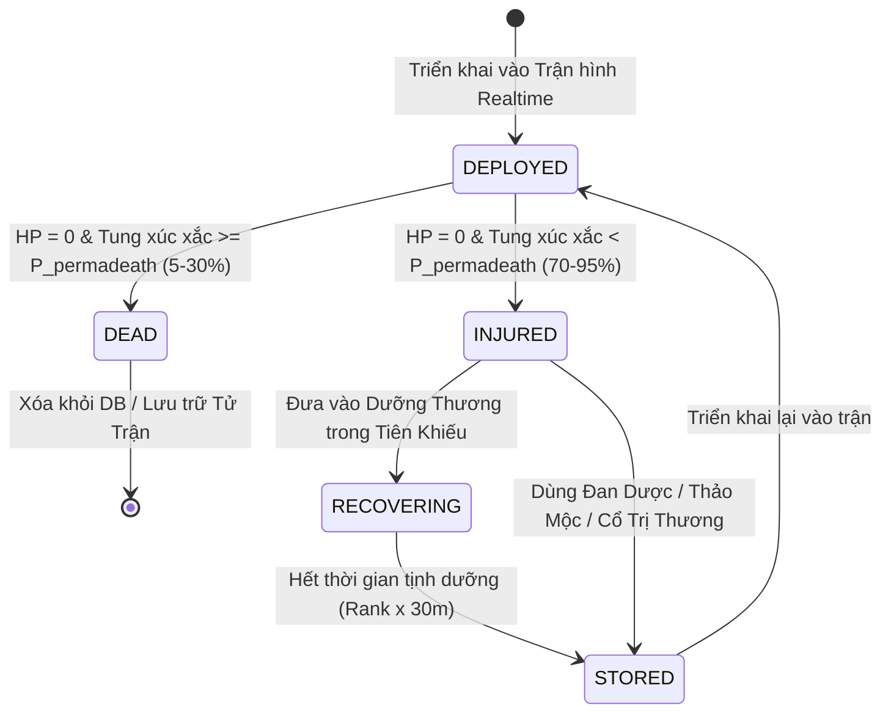

# Quy Tắc Phân Giải Tử Vong vs Trọng Thương & Dưỡng Thương (Companion Casualty & Recovery Specification)

## 1. Cơ Chế Phân Giải Khi Cạn HP (HP <= 0)

Khi một thực thể đồng hành (`EntityCompanion`) bị đánh cạn kiệt HP trong chiến đấu Realtime 20Hz:

1. **Minion Tạm Thời (`TTL > 0` từ Sát Chiêu Triệu Hồi Bầy Đàn)**:
   - Đơn giản là tan biến khỏi `sim.World`. Không ảnh hưởng đến dữ liệu lâu dài và không có Permadeath.
2. **Chiến Thú / Dị Nhân Thường Trực (Mang `ActorID` trong `non_player_actors`)**:
   - Tính toán xác suất **Tử Vong Vĩnh Viễn (Permadeath)** so với **Trọng Thương (Injured)** theo công thức nghiêm ngặt:

$$P_{\text{permadeath}} = \text{clamp}\Big( P_{\text{base}} + \Delta_{\text{overkill}} - B_{\text{loyalty}} - B_{\text{rank}}, \; 0.05, \; 0.85 \Big)$$

---

## 2. Bảng Thông Số Tính Toán Xác Suất

| Tham Số | Ý Nghĩa & Quy Tắc Tính | Giá Trị Cụ Thể |
| :--- | :--- | :--- |
| **$P_{\text{base}}$** | Tỉ lệ tử vong nền theo phẩm cấp/loài | • Thú Thường (Normal Beast): **0.40 (40%)**<br>• Dị Chủng (Elite Beast): **0.25 (25%)**<br>• Dị Nhân (`VARIANT_NPC`): **0.15 (15%)**<br>• Vương Thú / Hoang Thú (Boss/Desolate): **0.10 (10%)** |
| **$\Delta_{\text{overkill}}$** | Sát thương kết liễu vượt ngưỡng chịu đựng | Nếu sát thương đòn đánh cuối khiến HP âm $> 50\%$ Max HP:<br>$\Delta_{\text{overkill}} = \min\left(0.30, \; \frac{\|\text{HP âm}\|}{\text{MaxHP}} \times 0.5\right)$<br>*(Tối đa tăng +30% nếu trúng đòn cực mạnh nghiền nát)* |
| **$B_{\text{loyalty}}$** | Độ gắn kết & trung thành của thú | $B_{\text{loyalty}} = \frac{\text{Loyalty}}{100} \times 0.20$<br>*(Độ trung thành 100/100 giúp giảm 20% tỉ lệ tử vong)* |
| **$B_{\text{rank}}$** | Đẳng cấp sinh mệnh | $B_{\text{rank}} = 0.025 \times \text{Rank}$<br>*(Mỗi chuyển giảm 2.5% tỉ lệ tử trận)* |
| **Cổ Bảo Mệnh** | Trang bị Cổ thế mạng / Hộ thân | Nếu có mang hiệu ứng bảo mệnh (vd: Thể Đán Cổ): **$P_{\text{permadeath}} = 0$**, Cổ vào thời gian hồi chiêu dài |

---

## 3. Quy Trình Trạng Thái (Lifecycle State Machine)



### 3.1. Phân Giải Tử Vong Vĩnh Viễn (`DEAD`)
- Xóa khỏi `sim.World`.
- Server cập nhật CSDL bất đồng bộ qua queue worker:
  ```sql
  UPDATE non_player_actors
  SET lifecycle_state = 'DEAD', execution_state = 'DEAD', formation_slot = 0, updated_at = NOW(), version = version + 1
  WHERE id = $1 AND owner_player_id = $2;
  ```
- Ghi log audit: `pet.permadeath`.
- Gửi thông báo chia buồn đến người chơi: *"Chiến thú [Tên] đã tử trận nơi sa trường!"*

### 3.2. Phân Giải Trọng Thương (`INJURED`)
- Xóa thực thể khỏi map realtime, phát hào quang thu hồi.
- Cập nhật CSDL bất đồng bộ:
  ```sql
  UPDATE non_player_actors
  SET execution_state = 'INJURED', hp = 1, formation_slot = 0, updated_at = NOW(), version = version + 1
  WHERE id = $1 AND owner_player_id = $2;
  ```
- Trong trạng thái `INJURED`, không thể xếp thú vào Trận Hình để gọi ra map.

---

## 4. Cơ Chế Cứu Chữa & Phục Hồi

Người chơi có 3 phương pháp đưa thú từ `INJURED` trở lại `STORED` (sẵn sàng tham chiến):

1. **Dùng Đan Dược / Thảo Dược Cứu Thương**:
   - Sử dụng các vật phẩm như *Kim Sáng Dược*, *Sinh Cơ Đan*, hoặc Thảo mộc trồng trong Tiên Khiếu.
   - Thú phục hồi ngay lập tức $100\%$ HP và chuyển `execution_state = 'STORED'`.
2. **Kích Hoạt Cổ Trùng Trị Liệu**:
   - Cổ sư tiêu hao Chân nguyên của bản thân để vận dụng Cổ Trị Thương (Thanh Tuyền Cổ, Nhục Hoa Cổ...) trị thương cho thú.
3. **Dưỡng Thương Tự Nhiên (Tịnh Dưỡng Tiên Khiếu)**:
   - Thú tự hồi phục sau thời gian $T = \text{Rank} \times 30\text{ phút}$.
   - Khi hết thời gian, thú hồi phục $50\%$ HP và chuyển sang `STORED`.

### 4.1. Cơ Chế Tiêu Hao Thức Ăn (`Hunger Worker`)
- Khi ở trạng thái `INJURED` / `RECOVERING`, tốc độ tiêu hao thức ăn giảm $50\%$ (kế thừa logic trong `pet_hunger.go`).
- Nếu người chơi bỏ đói để `hunger <= 0` quá lâu, thú bị thương sẽ chết đói và chuyển thành `DEAD`.
