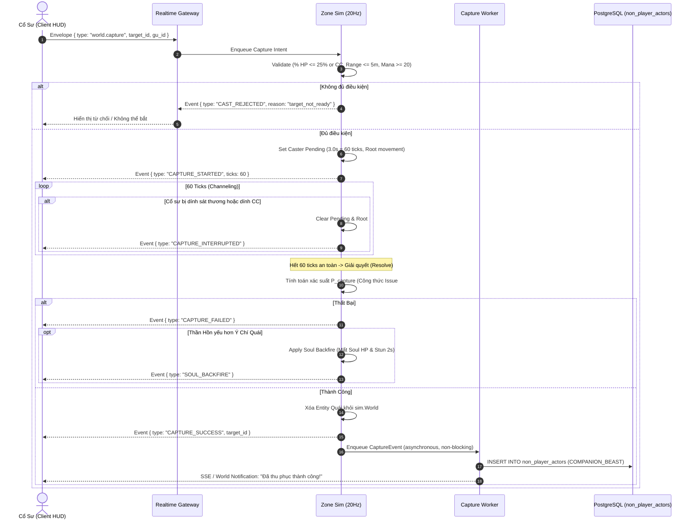

# Realtime Beast Enslavement (Nô Đạo Channeling) Specification

## 1. Tổng Quan Quy Trình

Cơ chế thu phục dã thú trong chiến đấu Realtime (20Hz zone sim) thay thế hoàn toàn hệ thống turnbase cũ. Cổ sư phải trực tiếp tiếp cận quái vật trên bản đồ thế giới, áp chế sinh lực quái, và tiến hành dẫn kênh (Channeling) kết ấn Nô Đạo.



---

## 2. Giao Thức Wire Protocol (`realtime/protocol`)

### 2.1. Client Intent Message
Thêm loại thông điệp mới vào `backend/internal/realtime/protocol/protocol.go`:
```go
const (
    TypeCapture = "world.capture"
)

type CaptureIntent struct {
    Seq      uint64 `json:"seq"`
    TargetID string `json:"target_id"`
    GuID     string `json:"gu_id"`
}
```

### 2.2. Server Sim Events
Được định nghĩa trong `backend/internal/realtime/combat/events.go`:
```go
const (
    EventCaptureStarted     EventType = "CAPTURE_STARTED"
    EventCaptureInterrupted EventType = "CAPTURE_INTERRUPTED"
    EventCaptureSuccess     EventType = "CAPTURE_SUCCESS"
    EventCaptureFailed      EventType = "CAPTURE_FAILED"
    EventSoulBackfire       EventType = "SOUL_BACKFIRE"
)
```

---

## 3. Điều Kiện Bắt Đầu Dẫn Kênh (Pre-conditions)

Khi nhận `CaptureIntent`, `Zone Sim` kiểm tra đồng thời 6 điều kiện trong tick:
1. **Trạng thái Cổ sư**: `HP > 0`, không bị Choáng (`isStunned == false`), không bị Câm lặng (`isSilenced == false`), không đang trong trạng thái niệm chiêu khác (`Combat.Pending == nil`).
2. **Trạng thái Mục tiêu**: Tồn tại trong zone, `HP > 0`, `Kind == EntityMonster`, `AI.Template.IsCapturable == true`.
3. **Ngưỡng Áp Chế**:
   - $\text{HP Pct} \le 25\%$ **HOẶC** Quái đang trúng hiệu ứng khống chế cứng (`STUN`, `FREEZE`, `PETRIFY`, `BIND`).
4. **Cự Ly**: $\text{Distance}(\text{Caster}, \text{Target}) \le 5.0\text{m}$.
5. **Cổ Trùng & Chân Nguyên**: Cổ sư sở hữu Nô Thú Cổ tương thích và đủ Chân nguyên (mặc định 20 Mana).

Nếu thỏa mãn:
- Gán `caster.Combat.Pending = &PendingCast{ Mode: ModeCapture, TargetID: target.ID, ResolveTick: w.tick + 60, MovementPolicy: "ROOT" }`.
- Phát sự kiện `CAPTURE_STARTED` (thời lượng 60 ticks = 3.0 giây).

---

## 4. Cơ Chế Ngắt Niệm (Interrupt Handling)

Trong mỗi chu kỳ 20Hz:
- Nếu Cổ sư di chuyển (nhận `Input.Move` mới) &rarr; Ngắt niệm, lý do `"moved"`.
- Nếu Cổ sư nhận bất kỳ sát thương nào (`w.applyDamageLocked`) &rarr; Ngắt niệm, lý do `"damaged"`.
- Nếu Cổ sư trúng hiệu ứng khống chế (`STUN`, `SILENCE`, `FREEZE`) &rarr; Ngắt niệm, lý do `"crowd_control"`.
- Khi ngắt niệm:
  - Hủy `caster.Combat.Pending = nil`.
  - Giải trừ trạng thái `ROOT`.
  - Phát sự kiện `CAPTURE_INTERRUPTED`.

---

## 5. Giải Quyết Hoàn Tất (Completion & Async Persistence)

Tại `w.tick == ResolveTick`:
1. **Tính toán xác suất thành công**:
   - Sử dụng hàm `CalculateCaptureChance` (kết quả vé #276).
2. **Nếu Thất Bại**:
   - Phát sự kiện `CAPTURE_FAILED`.
   - Nếu có phản phệ: Trừ `SoulHP` và gắn hiệu ứng `STUN` 2s lên Cổ sư.
3. **Nếu Thành Công**:
   - Xóa thực thể quái vật khỏi `sim.World` (`w.removeEntityLocked(target)`).
   - Phát sự kiện `CAPTURE_SUCCESS`.
   - **Xử lý lưu trữ bất đồng bộ (Non-blocking DB Persistence)**:
     - Đưa sự kiện vào `m.captureQueue <- CaptureEvent{ ... }` trong `manager.go` (tương tự như `m.deathQueue`).
     - `captureWorker` nhận sự kiện trong background goroutine và mở Transaction lưu trữ:
       ```sql
       INSERT INTO non_player_actors (
           id, actor_kind, owner_player_id, template_source, template_id,
           species, name, rank, hp, max_hp, base_attack, base_defense, speed,
           count, hunger, max_hunger, loyalty, lifecycle_state, execution_state,
           behavior_profile, formation_slot
       ) VALUES (
           gen_random_uuid(), 'COMPANION_BEAST', $1, 'MONSTER_TEMPLATE', $2,
           $3, $4, $5, $6, $7, $8, $9, $10,
           1, 0, 100, $11, 'ACTIVE', 'STORED',
           'PASSIVE', 0
       );
       ```
     - Zone tick không bao giờ bị nghẽn (zero tick stall).
