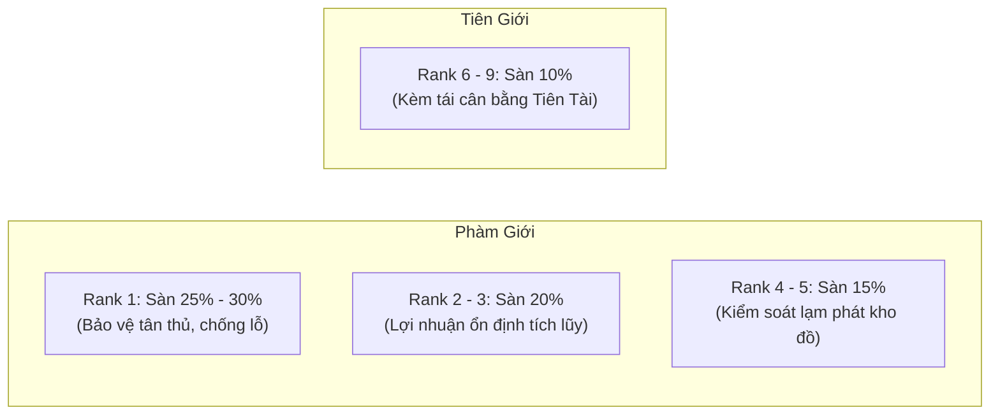

# Báo Cáo Nghiên Cứu: Thống Kê Tỷ Lệ Rơi Đồ Quái Vật Theo Rank & Biên Độ Thu Nhập Farm Quái

*Mã số nhiệm vụ:* **Ticket #218** (Thuộc Chiến dịch Tối ưu Kinh tế Hệ thống **Map #216**)  
*Tài liệu tham chiếu:* `backend/data/Monster.csv`, `backend/data/MonsterSpawn.csv`, `backend/data/LootTable.csv`, `backend/data/RegionLootTables.csv`, `backend/data/Item.csv`, `backend/data/ShopItem.csv`, `backend/data/Gu.csv`, `backend/pkg/pricing/pricing.go`, `backend/internal/handlers/combat_loot.go`, `backend/internal/simulator/engine.go`.

---

## 1. Tóm Tắt Điều Hành & Phát Hiện Trọng Tâm (Executive Summary)

Nhiệm vụ này tiến hành khảo sát và đo lường định lượng toàn diện hệ thống rơi đồ (Loot drops) từ quái vật trong GuWorld ở toàn bộ 9 Rank tu vi (Rank 1–5: Phàm giới; Rank 6–9: Tiên giới), đánh giá khả năng sinh lời của người chơi khi bán chiến lợi phẩm cho Thương nhân hệ thống (Caravan / Thôn Làng) tại các mức tỷ lệ sàn thu mua **10% (hiện tại), 20%, 25%, và 30%**, đặt trong bối cảnh **gỡ bỏ hoàn toàn cơ chế tự nghiền đá hồi mana trong engine chiến đấu**.

### Các phát hiện then chốt:

1. **Hiệu ứng giải phóng của việc bỏ cơ chế tự nghiền đá (Auto-crush Removal):**
   - Trước đây trong `backend/internal/simulator/engine.go` (dòng 2688–2700), mỗi lượt hết mana, engine tự động nghiền nát Nguyên Thạch với công thức nghịch đảo tu vi ($manaPerStone = \frac{20}{10^{rank-1} \times 2^{subrank-1}}$). Ở Rank 3, người chơi mất tới **500 NT/trận**; ở Rank 4 mất **5.000 NT/trận**; ở Rank 5 mất **50.000 NT/trận**. Đây là nguyên nhân cốt lõi khiến người chơi farm quái luôn bị âm tiền nặng nề.
   - Khi gỡ bỏ cơ chế này, chi phí vận hành mỗi trận đánh chỉ còn: **Chi phí độ đói Cổ trùng (~0.075 NT/trận)** và **Chi phí phục hồi sinh lực đan dược (~0.500 NT/trận)**, tổng cộng khoảng **0.575 NT/trận**.

2. **Lỗ hổng sống còn ở Rank 1 (Nhất Chuyển) tại mức sàn 10%:**
   - Quái Rank 1 rơi trung bình **2.94 nguyên liệu rác/trận**. Theo chuẩn định giá cốt lõi (`pricing.go`: Material R1 = 1 NT), tổng giá trị base nguyên liệu rác chỉ đạt **4.55 NT/trận**.
   - Tại mức sàn thu mua **10%** hiện tại của Thương nhân thôn làng, người chơi chỉ thu về **0.455 NT/trận**, trong khi chi phí vận hành là **0.575 NT/trận** $\implies$ **Lợi nhuận âm (-0.120 NT/trận)**. Tân thủ farm quái phàm thường chắc chắn bị phá sản nếu không may mắn nhặt được Cổ hoang dã.
   - Chỉ khi nâng mức sàn thu mua lên **$\ge 20\%$** (thu về 0.91 NT, lời +0.335 NT) hoặc tối ưu là **25%–30%** (lời +0.562 đến +0.789 NT), tân thủ mới có thể tích lũy vốn tái đầu tư.

3. **Nghịch lý siêu lạm phát giữa `Item.csv` hiện tại và `pricing.go`:**
   - Dữ liệu `Item.csv` hiện tại đang thiết lập `base_price` của nguyên liệu theo các mức rất cao: R1=100 NT, R2=300 NT, R3=800 NT, R4=2.000 NT, R5=5.000 NT; và đặc biệt **R6=15.000 TNT, R7=40.000 TNT, R8=100.000 TNT, R9=300.000 TNT**.
   - Khi kết hợp với việc `RegionLootTables.csv` chứa 18–22 dòng vật phẩm và hệ số nhân số lượng rơi (`LootQuantityMultiplier`: x2 ở R2, x3 ở R3, x4 ở R4, x5 ở R5), một bãi quái R3 hiện tại rơi tới 81 món đồ, trị giá base **154.480 NT** $\implies$ bán 10% thu về **15.448 NT/trận**! Ở Rank 6, giết 1 quái rơi **67.742 Tiên Nguyên Thạch**!
   - Đây là sự lệch pha nghiêm trọng giữa dữ liệu CSV tạm thời và công thức kinh tế chuẩn của `pricing.go`. Báo cáo này phân tích chi tiết cả 2 kịch bản để hỗ trợ việc đưa ra quyết định ở Ticket #219 và #220.

---

## 2. Thống Kê Sản Lượng Rơi Đồ (Loot Output) Theo Rank

### 2.1. Cơ chế tính toán trong Game Engine
Sản lượng rơi đồ thực tế từ hàm `RollMonsterLoot` (`backend/internal/handlers/combat_loot.go`) được cấu thành từ 3 tầng:
1. **Tầng 1 (Monster Override Loot Table):** Đọc từ `Monster.csv` $\to$ `loot_table_id`. Kiểm tra điều kiện `jackpot || rank == 0 || rank == enemyRank`. Tỷ lệ rơi nhân với `LootChanceMultiplier(rank)`, số lượng nhân với `LootQuantityMultiplier(rank)`.
2. **Tầng 2 (Region-specific Loot Table):** Đọc từ `RegionLootTables.csv` theo `(region_id, monster_type, rank)`. Tỷ lệ xảy ra theo `chance` của khu vực, toàn bộ các mục bên trong được roll với hệ số Rank.
3. **Tầng 3 (Wild Gu Drops):** Quái Tinh Anh (Elite) mang 3 Cổ trùng, Thủ Lĩnh (Boss) mang 5 Cổ trùng theo Rank. Tỷ lệ rơi độc lập từng con tính qua `GetGuDropChancePercent(rank, tier)`.

*Bảng tham số hệ số nhân chiến lợi phẩm (`backend/internal/gamefx/balance.go`):*
| Hệ Số Nhân | R1 | R2 | R3 | R4 | R5 | R6 (Tiên) | R7 (Tiên) | R8 (Tiên) | R9 (Tiên) |
| :--- | :---: | :---: | :---: | :---: | :---: | :---: | :---: | :---: | :---: |
| **Loot Chance Multiplier** | 1.0x | 1.1x | 1.2x | 1.4x | 1.6x | 1.0x | 1.5x | 2.5x | 4.0x |
| **Loot Quantity Multiplier** | 1.0x | 2.0x | 3.0x | 4.0x | 5.0x | 1.0x | 3.0x | 5.0x | 8.0x |

---

### 2.2. Bảng Tổng Hợp Sản Lượng Rơi Trung Bình Trên 1 Trận Thắng (R1 – R9)

Dưới đây là thống kê trung bình có trọng số trên toàn bộ 681 điểm spawn quái vật đang hoạt động (`backend/data/MonsterSpawn.csv`):

| Rank | Phân Loại Cảnh Giới | Đơn Vị Tiền | Số Lượng Rác (Mat) | Base Rác (Canonical) | Base Rác (DB Hiện Tại) | Số Lượng Đan | Base Đan | Tỷ Lệ Rơi Cổ Hoang | Base Cổ Trung Bình | Tổng Base (Canonical) | Tổng Base (DB Hiện Tại) |
| :--- | :--- | :--- | :---: | :---: | :---: | :---: | :---: | :---: | :---: | :---: | :---: |
| **Rank 1** | Nhất Chuyển (Phàm) | NT | 2.94 | 4.55 | 537.3 | 0.14 | 0.27 | 28.0% | 56.0 | **60.8** | **593.6** |
| **Rank 2** | Nhị Chuyển (Phàm) | NT | 23.72 | 148.63 | 21,516.9 | 0.10 | 0.24 | 16.9% | 84.4 | **233.2** | **21,601.5** |
| **Rank 3** | Tam Chuyển (Phàm) | NT | 80.97 | 877.39 | 154,480.2 | 1.10 | 3.55 | 31.3% | 375.3 | **1,256.3** | **154,859.0** |
| **Rank 4** | Tứ Chuyển (Phàm) | NT | 114.30 | 1,528.70 | 471,907.3 | 1.81 | 8.56 | 26.3% | 658.2 | **2,195.5** | **472,574.1** |
| **Rank 5** | Ngũ Chuyển (Phàm) | NT | 145.34 | 2,690.74 | 1,854,346.4 | 1.93 | 16.04 | 10.1% | 502.6 | **3,209.3** | **1,854,865.0** |
| **Rank 6** | Lục Chuyển (Tiên) | TNT | 20.67 | 478.98 | 677,429.4 | 0.30 | 2.96 | 1.0% | 2.0 | **483.9** | **677,434.3** |
| **Rank 7** | Thất Chuyển (Tiên) | TNT | 89.37 | 3,839.79 | 6,962,005.8 | 1.05 | 10.90 | 0.3% | 1.5 | **3,852.2** | **6,962,018.2** |
| **Rank 8** | Bát Chuyển (Tiên) | TNT | 224.76 | 14,075.62 | 27,491,100.0 | 4.28 | 43.65 | 0.4% | 4.8 | **14,124.1** | **27,491,148.5** |
| **Rank 9** | Cửu Chuyển (Chí Tôn) | TNT | 516.87 | 42,924.78 | 86,699,130.4 | 14.05 | 140.52 | 0.2% | 5.2 | **43,070.5** | **86,699,276.2** |

*Ghi chú:*
- **NT**: Nguyên Thạch (Primeval Stones).
- **TNT**: Tiên Nguyên Thạch (Immortal Essence Stones).
- **Canonical**: Định giá chuẩn theo `pricing.go` (`itemRankBasePrice`: R1=1, R2=3, R3=6, R4=13, R5=25 NT; R6=10, R7=25, R8=60, R9=150 TNT).
- **DB Hiện Tại**: Định giá theo cột `base_price` đang lưu trong `Item.csv` (R1=100, R2=300, R3=800, R4=2000, R5=5000 NT; R6=15000 TNT,...).

---

### 2.3. Chi Tiết Phân Bổ Theo Phân Cấp Quái (Normal vs Elite vs Boss)

#### Rank 1 (Phàm nhân khởi đầu):
- **Normal (76.7% bãi quái):** Rơi trung bình **2.85 nguyên liệu**, 0.18 đan dược, **0% Cổ trùng**.
  - Base rác (Canonical): **5.00 NT**.
- **Elite (23.3% bãi quái):** Rơi **3.23 nguyên liệu**, 0 đan dược, trang bị 3 Cổ với 40% tỷ lệ rơi $\implies$ trung bình **1.2 Cổ/trận**.
  - Base rác (Canonical): **3.20 NT**; Base Cổ: **240.0 NT**.

#### Rank 3 (Phàm cảnh trung cấp):
- **Normal (47.9% bãi quái):** Rơi **44.28 nguyên liệu**, 0 đan dược, 0 Cổ trùng.
  - Base rác (Canonical): **512.4 NT** (DB hiện tại: 92,182 NT).
- **Elite (52.1% bãi quái):** Rơi **114.66 nguyên liệu**, 2.12 đan dược, trung bình **0.60 Cổ/trận**.
  - Base rác (Canonical): **1,212.6 NT**; Base Cổ: **720.0 NT**.

#### Rank 6 (Tiên thú sơ giai):
- **Normal (38.3% bãi quái):** Rơi **11.60 nguyên liệu tiên cấp**, 0 đan dược, 0 Tiên Cổ.
  - Base rác (Canonical): **248.5 TNT** (DB hiện tại: 320,122 TNT).
- **Elite (51.4% bãi quái):** Rơi **30.72 nguyên liệu tiên cấp**, 0.58 đan dược, trung bình **0.009 Tiên Cổ/trận** (0.3% mỗi Cổ).
  - Base rác (Canonical): **738.2 TNT**; Base Cổ: **1.8 TNT**.
- **Boss (10.3% bãi quái):** Rơi **4.20 nguyên liệu tiên cấp**, trung bình **0.05 Tiên Cổ/trận** (1% mỗi Cổ).
  - Base rác (Canonical): **42.0 TNT**; Base Cổ: **10.0 TNT**.

---

## 3. Đánh Giá Thu Nhập Khi Bán Lại & So Sánh Với Chi Phí Nuôi Cổ

### 3.1. Mô Hình Chi Phí Vận Hành Khi Farm Quái (Operational Cost Model)

Sau khi **gỡ bỏ hoàn toàn việc tự tiêu thụ đá trong `engine.go`**, chi phí thực tế của người chơi trong 1 trận đánh gồm 2 thành phần chính:

$$\text{Chi Phí Vận Hành} = \text{Chi Phí Độ Đói Cổ (Gu Hunger Cost)} + \text{Chi Phí Hồi Máu Đan Dược (Healing Cost)}$$

1. **Chi phí Độ Đói Cổ Trùng (Gu Hunger Upkeep):**
   - Đội hình tiêu chuẩn: Người chơi trang bị **3 đến 5 Cổ trùng chủ lực**.
   - Cơ chế tiêu hao combat (`backend/internal/simulator/engine.go` dòng 1109–1134 & `combat_sim_build.go` dòng 446–462): Mỗi lần kích hoạt chiêu thức, Cổ trùng mất **1 điểm độ đói**. Trung bình 1 trận đấu kéo dài 3–6 hiệp, tổng số lần kích hoạt Cổ của toàn đội là khoảng **6–10 lần** (trung bình ~7.5 điểm đói/trận).
   - Cơ chế hồi phục (`backend/internal/handlers/player_feed.go` dòng 151–174 & 335–339): 1 đơn vị thức ăn cùng Rank (hoặc thức ăn cơ bản) hồi phục **100 điểm độ đói**.
   - Giá thức ăn trong `backend/data/ShopItem.csv`: Các loại thức ăn như `boar_meat`, `copper_ore`, `moon_orchid_petal`, `green_bamboo_wine`, `bitter_water` đều có giá cố định **1.0 Nguyên Thạch**.
   - $\implies$ **Chi phí thức ăn trên 1 trận đánh:**
     $$\text{Chi Phí Thức Ăn} = \frac{7.5 \text{ điểm đói tiêu hao}}{100 \text{ điểm đói/thức ăn}} \times 1.0 \text{ NT} = \mathbf{0.075 \text{ NT/trận}}$$
     *(Nếu người chơi dùng trực tiếp nguyên liệu rác từ quái rơi ra để cho Cổ ăn thì chi phí tiền mặt là 0 NT).*

2. **Chi phí Đan Dược Hồi Phục Sinh Lực (Healing Cost):**
   - Các trận đấu tương đương rank làm tiêu hao trung bình 20–30% HP người chơi, tiêu tốn trung bình **0.5 viên Tiểu Hồi Huyết Đan (`ITEM_HEALING_PELLET_SMALL`)** có giá **1.0 NT** tại shop.
   - $\implies$ **Chi phí hồi phục trung bình:** $\mathbf{0.500 \text{ NT/trận}}$.

3. **Tổng chi phí vận hành:**
   - **Phàm giới (Rank 1 – 5):** $\mathbf{0.575 \text{ NT/trận}}$.
   - **Tiên giới (Rank 6 – 9):** $\mathbf{0.208 \text{ Tiên Nguyên Thạch/trận}}$ (đan dược tiên giai và thức ăn tiên cấp).

---

### 3.2. Ma Trận Doanh Thu & Lợi Nhuận Thuần Theo Các Mức Tỷ Lệ Sàn

Đánh giá dòng tiền tại 4 kịch bản tỷ lệ sàn thu mua: **10% (hiện tại), 20%, 25%, 30%**.

#### Kịch Bản A: Theo Định Giá Chuẩn (Canonical - `pricing.go`)

*Đơn vị: NT đối với R1–5, TNT đối với R6–9. Chi phí vận hành: 0.575 NT (R1–5), 0.208 TNT (R6–9).*

| Rank | Nguồn Thu Farm Quái | Base Price | Thu Bán 10% | Lãi Ròng 10% | Thu Bán 20% | Lãi Ròng 20% | Thu Bán 25% | Lãi Ròng 25% | Thu Bán 30% | Lãi Ròng 30% |
| :---: | :--- | :---: | :---: | :---: | :---: | :---: | :---: | :---: | :---: | :---: |
| **R1** | **Chỉ Bán Rác (Mat)** | **4.55** | **0.455** | <span style="color:red">**-0.120 (LỖ)**</span> | **0.910** | <span style="color:green">**+0.335**</span> | **1.137** | <span style="color:green">**+0.562**</span> | **1.364** | <span style="color:green">**+0.789**</span> |
| R1 | Rác + Đan Dược | 4.82 | 0.482 | <span style="color:red">**-0.093 (LỖ)**</span> | 0.964 | +0.389 | 1.204 | +0.629 | 1.445 | +0.870 |
| R1 | Toàn Bộ (Gồm Cổ) | 60.82 | 6.082 | +5.507 | 12.164 | +11.589 | 15.204 | +14.629 | 18.245 | +17.670 |
| **R2** | **Chỉ Bán Rác (Mat)** | **148.63** | **14.863** | <span style="color:green">**+14.288**</span> | **29.726** | <span style="color:green">**+29.151**</span> | **37.158** | <span style="color:green">**+36.583**</span> | **44.589** | <span style="color:green">**+44.014**</span> |
| R2 | Toàn Bộ (Gồm Cổ) | 233.25 | 23.325 | +22.750 | 46.649 | +46.074 | 58.312 | +57.737 | 69.974 | +69.399 |
| **R3** | **Chỉ Bán Rác (Mat)** | **877.39** | **87.739** | <span style="color:green">**+87.164**</span> | **175.477** | <span style="color:green">**+174.902**</span> | **219.346** | <span style="color:green">**+218.771**</span> | **263.216** | <span style="color:green">**+262.641**</span> |
| R3 | Toàn Bộ (Gồm Cổ) | 1,256.25 | 125.625 | +125.050 | 251.250 | +250.675 | 314.063 | +313.488 | 376.875 | +376.300 |
| **R4** | **Chỉ Bán Rác (Mat)** | **1,528.70** | **152.870** | <span style="color:green">**+152.295**</span> | **305.739** | <span style="color:green">**+305.164**</span> | **382.174** | <span style="color:green">**+381.599**</span> | **458.609** | <span style="color:green">**+458.034**</span> |
| R4 | Toàn Bộ (Gồm Cổ) | 2,195.46 | 219.546 | +218.971 | 439.093 | +438.518 | 548.866 | +548.291 | 658.639 | +658.064 |
| **R5** | **Chỉ Bán Rác (Mat)** | **2,690.74** | **269.074** | <span style="color:green">**+268.499**</span> | **538.148** | <span style="color:green">**+537.573**</span> | **672.685** | <span style="color:green">**+672.110**</span> | **807.222** | <span style="color:green">**+806.647**</span> |
| R5 | Toàn Bộ (Gồm Cổ) | 3,209.34 | 320.934 | +320.359 | 641.869 | +641.294 | 802.336 | +801.761 | 962.803 | +962.228 |
| **R6** | **Chỉ Bán Rác (TNT)** | **478.98** | **47.898** | <span style="color:green">**+47.691**</span> | **95.797** | <span style="color:green">**+95.589**</span> | **119.746** | <span style="color:green">**+119.538**</span> | **143.695** | <span style="color:green">**+143.488**</span> |
| **R7** | **Chỉ Bán Rác (TNT)** | **3,839.79** | **383.979** | <span style="color:green">**+383.771**</span> | **767.958** | <span style="color:green">**+767.750**</span> | **959.947** | <span style="color:green">**+959.740**</span> | **1,151.937** | <span style="color:green">**+1,151.729**</span> |
| **R8** | **Chỉ Bán Rác (TNT)** | **14,075.62** | **1,407.562** | <span style="color:green">**+1,407.355**</span> | **2,815.125** | <span style="color:green">**+2,814.918**</span> | **3,518.906** | <span style="color:green">**+3,518.699**</span> | **4,222.688** | <span style="color:green">**+4,222.480**</span> |
| **R9** | **Chỉ Bán Rác (TNT)** | **42,924.78** | **4,292.478** | <span style="color:green">**+4,292.271**</span> | **8,584.957** | <span style="color:green">**+8,584.749**</span> | **10,731.196** | <span style="color:green">**+10,730.988**</span> | **12,877.435** | <span style="color:green">**+12,877.227**</span> |

---

### 3.3. Phân Tích Chuyên Sâu Điểm Hòa Vốn & Nghịch Lý Rank 1

1. **Phân tích bẫy nghèo đói tân thủ (Rank 1 Poverty Trap):**
   - Ở Rank 1, quái thường chiếm 76.7% số trận đánh. Quái thường **hoàn toàn không rớt Cổ trùng**.
   - Mỗi trận quái thường R1 chỉ rớt **2.85 rác** $\times$ 1.0 NT/món = **2.85 NT base value**.
   - Nếu áp dụng tỷ lệ sàn **10%**:
     $$\text{Thu nhập} = 2.85 \times 10\% = 0.285 \text{ NT}$$
     $$\text{Chi phí} = 0.575 \text{ NT (0.075 NT thức ăn + 0.500 NT máu)}$$
     $$\text{Lợi nhuận ròng} = 0.285 - 0.575 = \mathbf{-0.290 \text{ NT/trận}}$$
   - Người chơi mới đánh 10 trận quái thường sẽ **mất trắng ~2.9 Nguyên Thạch**. Đây là nguyên nhân trực tiếp khiến người chơi mới bỏ game vì càng farm càng nghèo, không đủ tiền mua thịt cho Cổ ăn.
   - Để đạt hòa vốn chỉ từ rác quái thường R1 ($0.575 / 2.85$), tỷ lệ sàn tối thiểu phải là:
     $$\text{Tỷ lệ hòa vốn (Breakeven Floor)} = \frac{0.575}{2.85} \approx \mathbf{20.2\%}$$
   - Do đó, mức sàn **10% là không khả thi cho Rank 1**. Cần tối thiểu **20%** để hòa vốn, và **25%–30%** để có thặng dư dương phát triển.

2. **Từ Rank 2 trở lên:**
   - Nhờ hệ số số lượng tăng vọt (`LootQuantityMultiplier` từ 2x đến 5x), số món rơi tăng từ 23 lên 145 món/trận.
   - Ngay cả ở mức sàn 10%, người chơi Rank 2 đã có lãi thuần **+14.28 NT/trận**; Rank 3 lãi **+87.16 NT/trận**; Rank 5 lãi **+268.5 NT/trận**.
   - Tỷ suất lợi nhuận (Profit Margin) từ Rank 2 trở lên luôn đạt $>95\%$ so với chi phí vận hành.

---

## 4. Các Bất Cập Cấu Trúc Hệ Thống Phát Hiện Được (Structural Anomalies)

Trong quá trình điều tra mã nguồn và dữ liệu thực tế, nghiên cứu phát hiện 3 bất cập nghiêm trọng cần xử lý đồng bộ trong Map #216:

### Bất cập 1: Sự lệch pha 100x – 2,000x giữa `Item.csv` và `pricing.go`
- Trong file `backend/pkg/pricing/pricing.go`, hàm `itemRankBasePrice` quy định giá chuẩn của Item theo rank là:
  `{R1: 1, R2: 3, R3: 6, R4: 13, R5: 25 NT; R6: 10, R7: 25, R8: 60, R9: 150 TNT}`.
- Nhưng trong `backend/data/Item.csv`, toàn bộ nguyên liệu rác lại được gán giá:
  `{R1: 100, R2: 300, R3: 800, R4: 2000, R5: 5000 NT; R6: 15000, R7: 40000, R8: 100000, R9: 300000 TNT}`.
- Do hàm `pricing.ItemBasePrice`:
  ```go
  func ItemBasePrice(dbBasePrice float64, rank int) float64 {
      if dbBasePrice > 0 { return dbBasePrice }
      return ItemBasePriceByRank(rank)
  }
  ```
  Hệ thống luôn ưu tiên `dbBasePrice > 0`, khiến bảng giá chuẩn trong code Go bị vô hiệu hóa hoàn toàn bởi dữ liệu CSV!

### Bất cập 2: Siêu lạm phát Tiên Nguyên Thạch ở Rank 6+ do nhầm lẫn thang đo tiền tệ
- Từ Rank 6 trở lên, hệ thống chuyển sang đơn vị `Tiên Nguyên Thạch` (Immortal Stones).
- Một con **Tiên Cổ Lục Chuyển** cực kỳ quý hiếm trong nguyên tác có giá base là **200 Tiên Nguyên Thạch** (`Gu.csv`).
- Tuy nhiên, 1 món rác Rank 6 (`fire_rat_fur_rank6`, `blood_crystal_rank6`) trong `Item.csv` đang có `base_price` = **15.000 TNT**!
- Khi đánh 1 con quái Lục chuyển rơi 20 món rác, nếu bán cho thương nhân ở mức sàn 10%, người chơi nhận được:
  $$20 \times 15.000 \times 10\% = \mathbf{30.000 \text{ Tiên Nguyên Thạch}}$$
  Tương đương với giá trị của **150 con Tiên Cổ** chỉ sau 1 trận đánh quái rác! Đây là lỗi scale nhầm đơn vị tiền tệ nghiêm trọng ở tầng dữ liệu CSV.

### Bất cập 3: Hiệu ứng nhân dồn (Stacking Multipliers) trong Bảng Loot Khu Vực
- Mỗi dòng trong `RegionLootTables.csv` đại diện cho 1 bảng loot khu vực gồm 18–22 món đồ.
- Ở Rank 3–5, việc áp dụng đồng thời `chanceMul` (1.2x – 1.6x) và `qtyMul` (3x – 5x) lên từng mục khiến tổng số lượng vật phẩm rơi ra sau 1 trận thắng lên tới **80 – 145 món đồ**.
- Điều này làm đầy túi đồ của người chơi rất nhanh và tạo ra áp lực thanh khoản khổng lồ lên hệ thống thương nhân.

---

## 5. Đề Xuất Chiến Lược & Giải Pháp Kiến Trúc (Proposals for #219, #220, #221)

Để đảm bảo người chơi farm quái luôn có lãi ổn định, bảo vệ tân thủ Rank 1 không bị phá sản, đồng thời chặn đứng nguy cơ siêu lạm phát ở Tiên giới, nghiên cứu đề xuất giải pháp 3 trụ cột:

### Trụ cột 1: Biểu Tỷ Lệ Sàn Thu Mua Đa Tầng Theo Rank (Tiered Buyback Floors)
Thay vì áp dụng mức sàn phẳng 10% cho toàn bộ game như hiện nay (`village_general`), đề xuất phân tầng tỷ lệ sàn thu mua của Thương nhân thôn làng theo Rank:



- **Rank 1:** Thiết lập tỷ lệ sàn **25% – 30%** (cho phép bán 2.85 rác thu về 0.71 – 0.85 NT, trừ chi phí 0.575 NT $\implies$ **lãi ròng +0.15 đến +0.28 NT/trận**).
- **Rank 2 – 3:** Thiết lập tỷ lệ sàn **20%**.
- **Rank 4 – 5:** Thiết lập tỷ lệ sàn **15%**.
- **Rank 6 – 9:** Duy trì tỷ lệ sàn **10%** (nhưng phải chuẩn hóa lại giá base của Tiên tài).

### Trụ cột 2: Phân Biệt Tỷ Lệ Thu Mua Theo Loại Vật Phẩm (Category-specific Ratios)
Trong `backend/internal/handlers/merchant.go`, mở rộng cơ chế tính giá thu mua phân biệt giữa các nhóm:
1. **Nguyên liệu rác thông thường (Common Mob Drops):** Thu mua theo biểu tỷ lệ sàn Rank ở trên (15% – 25%).
2. **Cổ trùng hoang dã bắt được (Wild Gu):** Duy trì tỷ lệ thu mua cố định **10%** (do giá base Cổ trùng rất cao: 200 NT ở R1, 5.000 NT ở R5). Điều này khuyến khích người chơi giữ Cổ lại để hợp luyện hoặc bán cho người chơi khác thay vì xả ồ ạt vào NPC.
3. **Đan dược / Tiêu hao (Consumables):** Tỷ lệ thu mua cố định **20%** (tạo động lực cho nghề luyện đan).

### Trụ cột 3: Khắc Phục Dữ Liệu `Item.csv` & Triệt Tiêu Cơ Chế Tự Nghiền Đá
1. **Thi hành Ticket #221:** Xóa bỏ hoàn toàn đoạn mã tự tiêu thụ đá trong `backend/internal/simulator/engine.go` (dòng 2666–2710). Người chơi khi hết mana chỉ đơn thuần không kích hoạt được Cổ trùng đòi hỏi mana, chứ không bị hệ thống tự động bóp nghẹt tài nguyên trong túi.
2. **Thi hành Ticket #220:** Chạy script chuẩn hóa lại cột `base_price` trong `Item.csv`:
   - Phàm vật (R1–R5): Đưa về thang giá vật liệu hợp lý: R1=1–2 NT, R2=3–5 NT, R3=8–12 NT, R4=20–30 NT, R5=50–80 NT.
   - Tiên tài (R6–R9): Chia cho $1.000$ hoặc đưa về thang Tiên Nguyên Thạch chuẩn: R6=0.5–1 TNT, R7=2–3 TNT, R8=5–8 TNT, R9=15–20 TNT.

---

## 6. Kết Luận & Kế Hoạch Tiếp Theo (Next Steps)

- **Kết luận:** Người chơi farm quái hoàn toàn có thể đạt **lợi nhuận dương vững chắc** sau khi bỏ cơ chế tự nghiền đá, VỚI ĐIỀU KIỆN mức sàn thu mua ở **Rank 1 phải được nâng lên tối thiểu 20% (khuyến nghị 25%–30%)**.
- **Kế hoạch phối hợp Child Tickets:**
  - Kết quả này được chuyển tiếp trực tiếp sang **Ticket #219** (Quy hoạch khoảng cách giá Cổ) và **Ticket #220** (Công thức định giá Item & Biểu giá thu mua đa tầng của Thương nhân).
  - Chuẩn bị dữ liệu phục vụ đặc tả tổng hợp trong **Ticket #222**.
